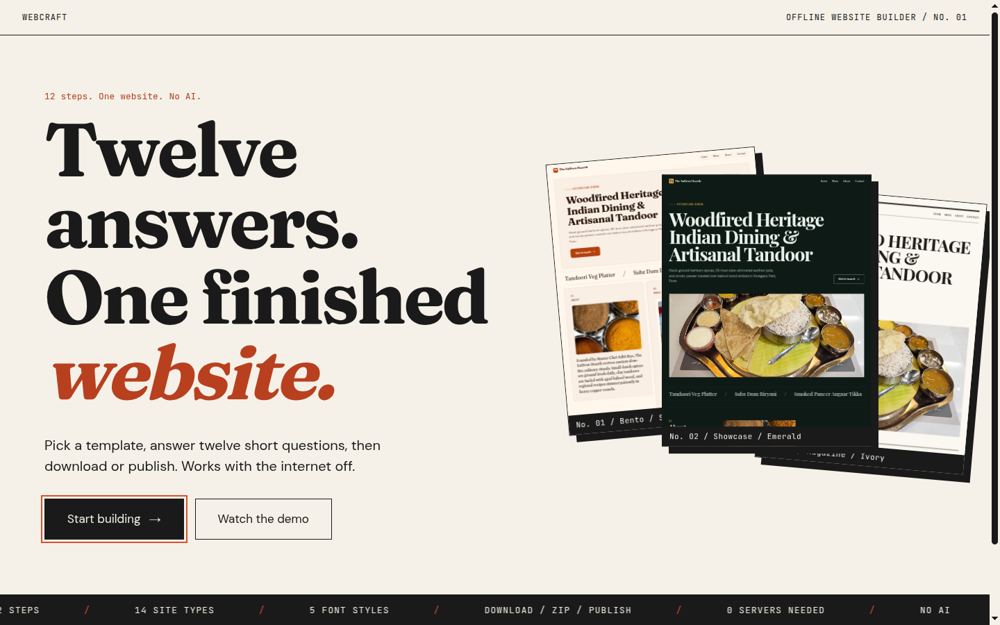
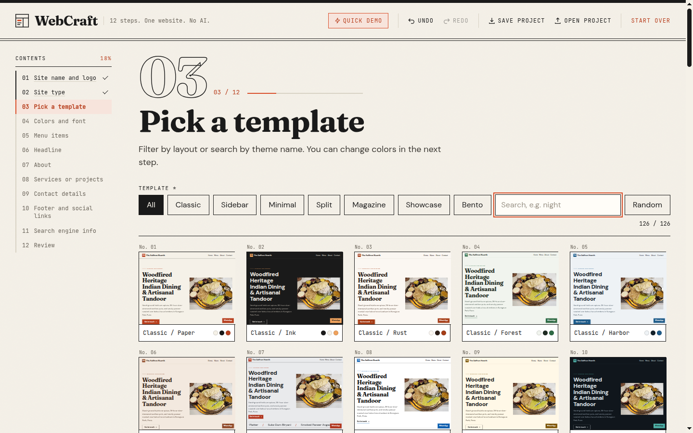
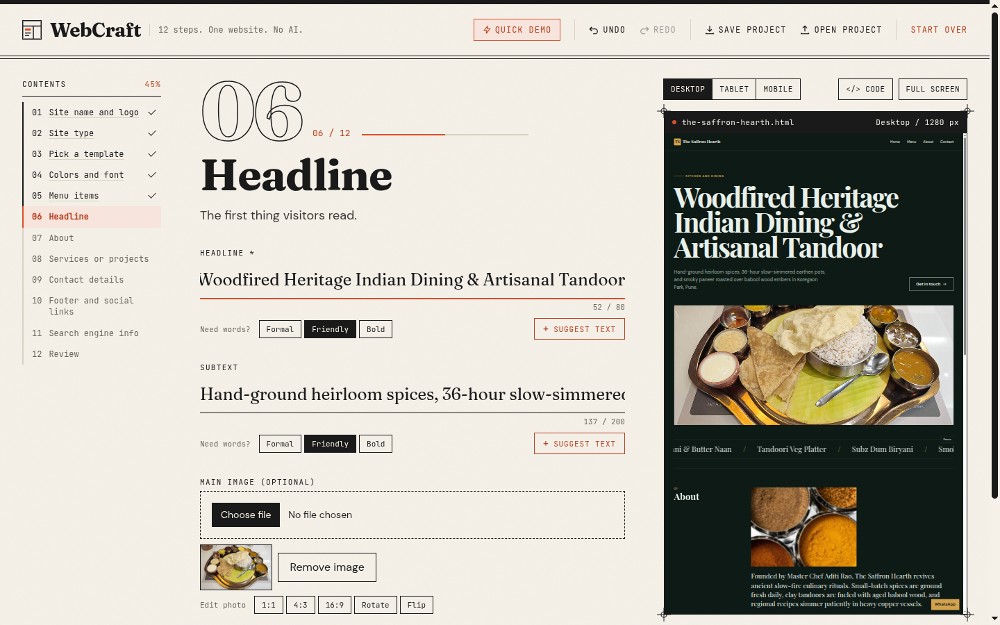
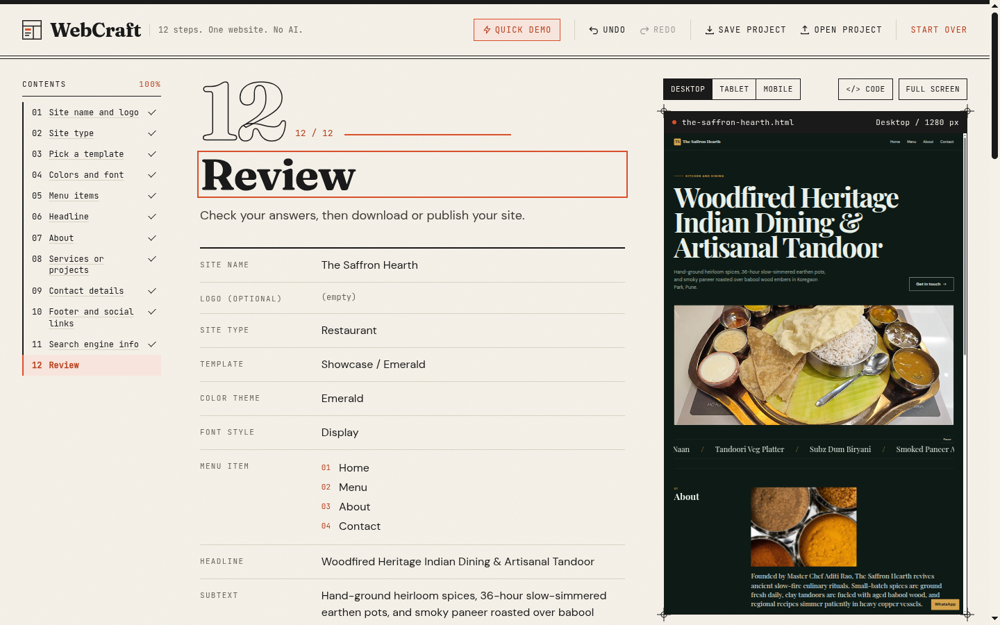
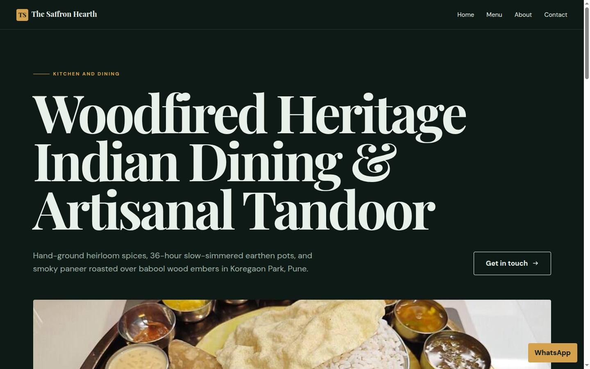
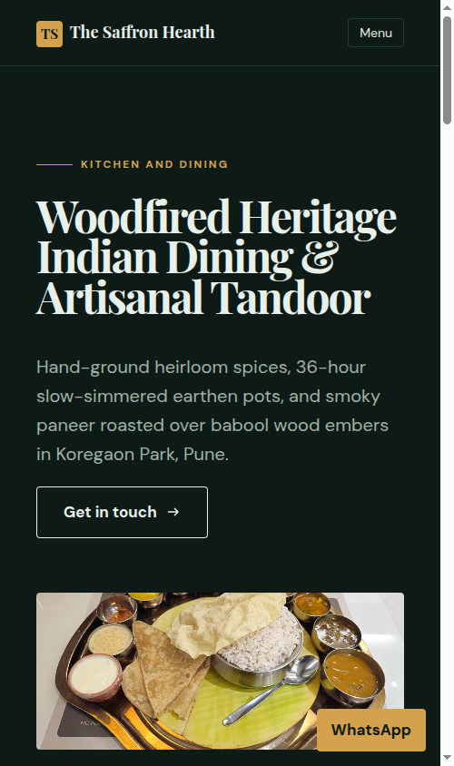

# WebCraft — Project Report

B.Tech Mini Project. *12 steps. One website. No AI.*

## 1. Abstract

WebCraft is a website builder that runs in the browser. The user answers 12 short steps (multiple choice and text fields). The app puts those answers into pre-written code and produces a finished one-page website. The user can preview it at three screen sizes, download it as one HTML file or a ZIP, or publish it on a local server and open it on a phone through a QR code.

It is written in plain HTML, CSS and JavaScript. It uses no framework, no AI and no API calls, and it works with the internet switched off.

## 2. Problem and goal

Small shops, students and event organisers need a simple website but cannot write code. Online builders need an account, the internet and often a payment. AI builders give different output every time and need a paid API.

Goal: a builder that is **predictable, offline, free and fully explainable**. The same answers always give the same site.

## 3. Tools used

| Part | Tool |
|---|---|
| Builder UI | HTML5, CSS3, JavaScript (ES6), no framework |
| Fonts | Local `.woff2` files (Fraunces, DM Sans, JetBrains Mono, Playfair Display, Space Grotesk; all OFL) |
| ZIP export | JSZip (local copy in `js/lib/`) |
| QR code | qrcode-generator (local copy in `js/lib/`) |
| Publish server | Node.js + Express (`server.js`) |
| Testing | Chrome, DevTools device sizes, curl for the server |
| Version control | Git, GitHub |

## 4. System design

### 4.1 Flow chart (user)

```
            +-------------------+
            |   Open index.html |
            +---------+---------+
                      |
          saved project in localStorage?
             |                    |
            no                   yes
             |                    |
     +-------v-------+            |
     |  Cover screen |            |
     +-------+-------+            |
             |                    |
     +-------v--------------------v-------+
     |   Step N of 12: show question      |<-----------+
     +-------+----------------------------+            |
             |                                         |
     user answers -> validate                          |
             |                                         |
        valid?  --- no ---> show error under field ----+
             |
            yes
             |
     save to state + localStorage, update live preview
             |
         N < 12 ? --- yes ---> Next (N + 1) -----------+
             |
            no
             |
     +-------v-------------------------------------+
     | Review: health score, accessibility check   |
     +-------+-------------+-------------+---------+
             |             |             |
      Download HTML    Download ZIP   Publish (local server)
                                          |
                               site served at localhost:3000/name
                               + QR code for a phone on the same WiFi
```

### 4.2 Data flow

```
form answers -> state object -> layout(state, theme) -> HTML string -> iframe (preview) / file (download)
```

- **One `state` object** holds every answer.
- **Steps are data**: each step is one object in `js/steps.js`. One engine in `js/app.js` draws every step. No step page is written by hand.
- **A theme** is an object of colours, fonts, radius, spacing and shadow (`js/themes.js`, 18 themes).
- **A layout** is a function `(state, theme) => htmlString` (`js/layouts.js`, `js/layouts2.js`, 7 layouts).
- **Templates** = every layout x every theme, made by a loop in `js/templates.js`: 7 x 18 = **126 templates**. Adding one theme object adds 7 templates with no new code.

### 4.3 Module list

| File | Job |
|---|---|
| `js/steps.js` | The 12 steps as data |
| `js/app.js` | Wizard engine, state, validation, progress |
| `js/categories.js` | 14 site types with smart defaults |
| `js/themes.js`, `js/layouts*.js`, `js/parts.js` | Themes, layouts, shared site parts |
| `js/templates.js`, `js/gallery.js` | Template list, gallery with filter, search, random |
| `js/preview.js` | Live preview iframe: desktop, tablet, mobile |
| `js/history.js` | Undo / redo (Ctrl+Z, Ctrl+Y) |
| `js/upload.js`, `js/imagetools.js` | Image upload, crop, rotate, flip |
| `js/a11y.js`, `js/health.js` | Accessibility check, site health score |
| `js/export.js`, `js/seo.js`, `js/legal.js` | HTML / ZIP / JSON export, SEO pack, privacy and terms pages |
| `js/qr.js`, `js/inbox.js` | QR code for phone share, contact form inbox |
| `js/utils.js` | `escapeHTML`, validation, save / load |
| `server.js` | Express publish server, contact form messages |

## 5. Screenshots

**Cover screen (first visit)**



**Step 3: template gallery (126 templates, filters, search)**



**Step 6: headline with live preview**



**Step 12: review**



**Generated site: desktop and mobile**





## 6. Security and validation

- Every user text goes through `escapeHTML()` before it enters an HTML string. This stops XSS: a `<script>` headline shows as text.
- `innerHTML` is never used with raw user text.
- Every field has a max length. Required fields block Next. Email, phone and UPI ID are checked.
- Links must start with `http://` or `https://`; `javascript:` links are dropped.
- Publish name: only `a-z`, `0-9` and `-`. `..`, `/` and `\` are blocked, so a name cannot reach other folders.
- `POST /publish` and `GET /messages` only accept requests from this computer. Other WiFi devices can only view sites and send messages.
- Visitor messages are stored in `messages/`, outside `sites/`, so nobody can open them by URL.
- Images: only PNG, JPG, SVG or WebP. Photos are shrunk in the browser to stay under 500 KB.
- Opened project files are checked field by field. Unknown or wrong-type fields are skipped.

## 7. Testing

The full test table (Input / Expected / Actual / Pass-Fail) is in [TESTS.md](../TESTS.md). It has **156 rows: 155 pass, 0 fail**. Row 8 (run in Edge) is still to be checked by hand on a Windows machine. Key cases:

| Input | Expected | Result |
|---|---|---|
| Empty site name, press Next | Error under field, Next blocked | Pass |
| `<script>alert(1)</script>` as headline | Shown as plain text, no script runs | Pass |
| 300-character text | Stops at the field's max length, error shown | Pass |
| Photo over 500 KB | Shrunk to WebP under 500 KB; files over 5 MB refused with error text | Pass |
| Refresh in the middle (step 5) | Same step and answers come back | Pass |
| Every layout at 375 / 768 / 1280 px | No sideways scroll | Pass |
| Publish with name `../bad` | Server refuses: "Site name can only use a-z, 0-9 and -" | Pass |
| Publish from another WiFi device | 403, nothing saved; the site still opens | Pass |
| Internet switched off | Builder and generated-site fonts load from local files | Pass |

## 8. Hosting (honest note)

Real public hosting needs a server and a domain. WebCraft gives three outputs: a single HTML file, a ZIP, and a local publish at `localhost:3000/<name>` that phones on the same WiFi can open. The next step for a public site is to upload the downloaded file to GitHub Pages or Netlify Drop; the builder shows these steps. That part needs the internet.

## 9. Limitations

- Publishing is local only; there is no real domain.
- One page per site (the ZIP adds privacy, terms and 404 pages).
- No database and no login. Contact form messages work only on the local publish server.
- Text suggestions come from a fixed bank of pre-written lines, not from AI, so the choice is limited.
- Photos are stored inside the file as base64, so many photos make the file big.

## 10. Future scope

- One-click upload to a cloud host.
- User accounts to keep several projects online.
- Multi-page sites (separate About, Menu and Contact pages).
- More layouts and themes (each new theme adds 7 templates with no new code).
- More languages for the builder and the generated sites (Hindi, Marathi).

## 11. Conclusion

WebCraft shows that a useful website builder does not need AI or a framework. Keeping steps, themes and layouts as data lets one small engine produce 126 templates for 14 site types, all offline, safe against XSS and easy to explain line by line.
